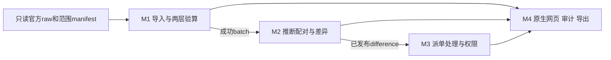

# 怎么做

详细设计v0.1，2026-10-13；**未施工/未运行**。功能编号以[要做什么](要做什么.md)为唯一清单；具体文件、schema、接口与错误码以[文件结构与接口契约](文档/研究/文件结构与接口契约.md)为协作契约。

## 1 技术与数据流

已确认FastAPI后端、SQLite、原生HTML/JS/CSS同源网页。不用React/Vue、Node构建、Jinja。浏览器静态页面→Fetch JSON→web router→services事务编排→domain纯规则→repositories SQLite。domain无HTTP/文件/数据库IO；web不直接写SQL；repository不自行决定配对/流转。

只读官方xlsx→未来只读完整扫描和范围manifest→真实10k原始快照（建议Year 2010-2011行2–10001）→导入规范化/逐行裁决→正向lot与取消视图→固定规则run→匹配分配+差异→派单处理。两边视图是一个数据源的不同符号记录，不代表独立账本。raw永不改写；快照保留原字段文字值、日期序列/元数据和源身份，金额规范化放导入阶段计时内，不预先计算匹配/裁决以缩短性能。

## 2 四个独立可验收模块

| 模块 | 输入/输出 | 主要FR | 验收边界 |
| --- | --- | --- | --- |
| M1数据准备与导入验算 | raw/manifest/快照→source、snapshot、batch、逐行裁决、两层计数 | FR-01至FR-09、FR-26、FR-31 | TC-01至TC-22；失败无成功事实行 |
| M2保守对账与差异 | 成功batch+规则→lot、run、allocation、difference | FR-10至FR-16 | TC-23至TC-32；不猜真实原单 |
| M3派单处理与权限 | difference+会话+version→assignment、工单状态 | FR-17至FR-23、FR-28、FR-29 | TC-33至TC-42；服务鉴权与真实并发 |
| M4网页查询审计导出 | run/差异/审计→原生页面、分页JSON、授权CSV、证据 | FR-24、FR-25、FR-27、FR-30、FR-32 | TC-43至TC-48；成功事务原子与安全导出 |

横向web/domain/service/repository是代码分层，不另算4个业务模块。网页不是额外模块。M1输出batch供M2，M2输出difference供M3，M4查询三者；各模块接口可独立测试且有数据往来。

此图是设计示意，不代表已运行的数据或页面。

## 3 导入与分母

读取worksheet所有实际值以识别最後含值单元格行L，数据位置为第2–L行；中间没有row XML也按原位置计EMPTY_ROW；只格式尾行不计；表头校验单独处理。扫描两表的N=sum(L-1)，不能把dimension当扫描完成。不读取值便推最后行不合格。原文件=选中10k+范围外，范围外包含未选sheet/同sheet其它源位置；批次输入10k=正向有效+取消有效+规则排除。显示两层差0，不以清洗后行数反推分母。源行严重结构错误/无可靠位置应中止整个批次，不强编计数。

主原因按CR-02先后只取首个，其余flags不增加排除计数。合法字母StockCode保留，缺CustomerID/Description/Country保留；数量、日期、非正价、超精度和符号冲突按规则排除。每行有唯一(source SHA,sheet,row)，相同内容不同原行保留且标重复。截断发票仅标风险，后续不扩大抽样而隐瞒范围改变。

## 4 金额方案

从源数值十进制字符串Decimal读取，四位ROUND_HALF_UP候选q，abs(raw−q)≤1e-9才去尾差；否则排除PRICE_PRECISION_UNSUPPORTED；raw≤0排除。price_units=q×10000整数，金额单位也是£0.0001，量为整数；绝不通过float或两位UI显示作比较。字段金额JSON用十进制整数字符串，避免JS超过2^53，服务校验SQLite64位整数上限，超界排除/报错不截断。quantity在SQLite有符号64位范围；NaN/±Infinity主排除INVALID_NUMBER_OR_DATE，数量、price_units、line_amount_units或取消绝对量64位溢出同主码+NUMERIC_OVERFLOW flag，不截断。累计lot量/run金额溢出则run失败NUMERIC_OVERFLOW、不部分发布，不改源行裁决。尾差恰1e-9接受、略超拒绝PRICE_PRECISION_UNSUPPORTED（TC-14明确输入）。展示ROUND_HALF_UP两位只影响显示。B02需全量精度报告，若真实高精度不能支持，协调端调整版本与TC，不静默清洗掉后假称全部适用。

## 5 保守配对 推荐待用户确认

规则版本建议 conservative-v1、窗口90×24小时含边界，窗口是设计建议不是UCI官方事实。规范商品/客户/价格保持精确；描述从不作键。lot键=(InvoiceNo,CustomerID,StockCode,price_units,InvoiceDate)，保留行引用与总量；国家非空集合有多个不同值则lot本身质量冲突。缺客户的正向量保留但不能匹配；取消缺客户生成差异。

按取消时间、sheet、源行处理，每次用同一客户/商品且时间在[cancel−window,cancel]内的lot做证据查询。全部价格/国家诊断用于价差/国家冲突说明；精确价格lot候选数不以剩余量先过滤，避免两个候选中耗尽一个就伪装唯一。任何匹配相关疑似重复或非空国家冲突不自动配对。仅唯一lot剩余量足够时全额分配abs(cancel_quantity)，剩余量递减；不跨lot、不部分满足一条取消、不按最近时间猜。单条取消状态MATCHED或UNMATCHED；每run×取消源行最多一主要差异。

主差异优先级：MISSING_CUSTOMER→SUSPECTED_DUPLICATE→COUNTRY_CONFLICT→MULTIPLE_CANDIDATES→INSUFFICIENT_QUANTITY→PRICE_MISMATCH→NO_CANDIDATE_IN_RANGE。价差是同客户商品时间有lot、但无精确价格候选；数量不足是唯一精确候选量不足；全部证据/次要flags均可见。无范围内候选文案“当前范围未找到候选，范围外原单可能存在”。取消排除行只进M1排除计数，不重复变差异；有效取消无客户等才走M2差异。

## 6 生命周期与事务

batch导入在一个服务事务中写row_verdict与计数，错误回滚；失败批次元记录/拒绝日志可在独立事务保留，不能把partial rows当成功。源、快照校验通过后注册；成功batch唯一snapshot+normalization_version；重复失败可按attempt重试，无成功事实重复。

run唯一snapshot+normalization_version+matching_rule_digest。状态RUNNING→COMPLETED/FAILED；先登记run，完成计算后单一事务写lot/allocation/difference/摘要与COMPLETED审计；查询只发布COMPLETED。意外中断RUNNING需检查过期并标失败，在同run内新attempt重算、不另造差异；同规则重跑返回相同run_id。SQLite单写者限制，以短提交事务、busy_timeout有限重试和503 DATABASE_BUSY处理，不采用无限重试或多worker掩饰。pipeline导入SUCCESS后run失败，不回滚已成功batch；错误details保留batch_id/run_id/attempt/retry_action=POST_RUNS。页面以既有batch_id和同规则POST /runs重试同run新attempt，成功200；COMPLETED仅复用、RUNNING返回409，不重复上传触发DUPLICATE_IMPORT。

工单：待处理未派单→派单仍待处理→责任人开始处理中→责任人非空说明关闭。分配表difference唯一；二次派单即使同人也409 ALREADY_ASSIGNED返回当前人；关闭后403/409而非重派。变更携带expected_version；服务先按契约完成会话→变更安全→角色→结构字段→对象范围，再校验领域/version与状态，原子更新并写成功audit。版本竞争409 VERSION_CONFLICT，UI重新取详情但不自动再提交。对已有派单的请求首先检查ALREADY_ASSIGNED再版本，保证显示当前人；其他修改先version再流转，测试固定同次序。

匹配状态与工单状态独立。关闭不新增allocation、不重新计算金额、不改raw。管理员不是业务超级用户：初期不授予导入、派单、关闭权限；不能靠前端role调用。身份用后端session：HttpOnly session Cookie与JS可读独立csrf_token Cookie均SameSite=Strict/Path=/、无Domain，本机HTTP Secure=false、HTTPS须true。登录生成会话稳定随机token、DB仅存hash，200返回user并设两Cookie；GET/me仅user，不恢复/轮换token。每次变更从Cookie取token送header，后台验证session的csrf_hash及Origin，不只比客户端两值；多HTML导航/刷新/双标签均保持。logout撤销且清两Cookie，停用/过期立即401；不存localStorage。登录豁免既有CSRF但必验Origin；Origin缺失/null/不同源拒绝403 ORIGIN_FAILED，其它已登录变更必验CSRF+Origin。顺序会话→安全校验→角色→结构字段→对象范围→领域，domain未派单仅NOT_ASSIGNED，对外可能先403/404；详见契约。密码哈希采用施工时核验的成熟库，不自造加密。

## 7 前端与接口

静态HTML由FastAPI提供；assets在/static，JSON在/api/v1，页面不要file://打开。会话通过credentials=same-origin Fetch；普通body接口JSON，imports/pipeline为FormData multipart自动boundary，CSV下载不是JSON，未知字段统一422。前端显示role/可用动作只是提示，后端复验。页面：login→import+校验→results+run摘要→differences列表→detail候选/派单/开始/说明关闭；counts验算可从import/results双入口进入。处理人列表仅本人；401回登录、403解释权限、409刷新当前责任人/version但不丢用户说明，422按字段标错、503给重试提示。

输入仅选择服务已登记snapshot_id，不接收任意本机路径，不开放自定义路径读取。CSV导出后台鉴权、逐字段转义+公式注入防护，附来源hash/规则和显示/整数金额。DOM采用textContent显示不可信描述/说明，不innerHTML拼接。

## 8 施工顺序与状态

[总计划](文档/施工/B00-总计划.md)→B01环境/骨架→B02只读扫描快照→B03存储导入→B04匹配→先固定身份/角色/对象契约，B05受控actor域/服务测试、B06独立会话后集成（不互为阻塞）→B07网页→B08审计导出→B09测试性能→B10工程过程→B11报告/现场。当前B仅操作规格，拟建文件都在Markdown清单，不创建空代码骨架。普通可逆工作在以后明确施工授权范围内自主执行，不额外加逐文件审批门；越范围/不可逆操作按授权与MARINA审批，保护未提交工作。

索引与SQLite事务/Decimal等技术依据及选型取舍见[研究比选](文档/研究/外部资料与方案比选.md)。目前无性能结果、自动化通过或第三项配对拍板证据。
